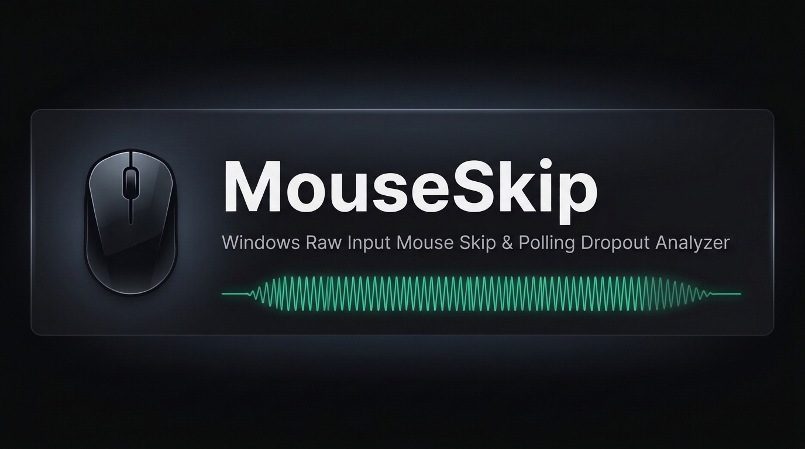
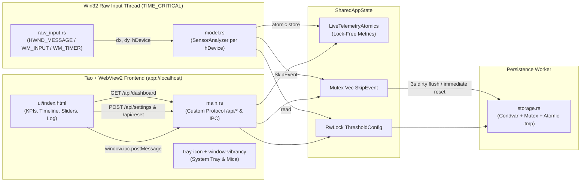

<div align="center">



<br />
<br />

[](https://www.rust-lang.org/)
[](https://www.microsoft.com/windows)
[](#%EF%B8%8F-architecture-overview)
[](https://developer.microsoft.com/en-us/microsoft-edge/webview2/)
[](#license)
[](https://github.com/Lukas-eft/MouseSkip/pulls)

**A high-performance Windows Raw Input (`WM_INPUT`) mouse skip, polling dropout, and sensor spinout analyzer.**

[Key Features](#-key-features) •
[Quick Start](#-quick-start--setup-guide) •
[Detection Engine](#-detection-engine--heuristics) •
[Architecture](#-architecture-overview) •
[Controls](#-controls--calibration) •
[Storage & Config](#-storage--configuration)

<br />

</div>

---

## ✨ Key Features

### 🎯 Hardware-Level Raw Input Engine
- **Direct `WM_INPUT` HID Capture:** Registers a dedicated message-only sink window (`HWND_MESSAGE`) for Generic Desktop Mouse (`0x01 / 0x02`) with `RIDEV_INPUTSINK`, capturing raw sensor deltas even while minimized to the tray or behind fullscreen 3D games (immune to OS cursor acceleration and game camera cursor-reset warps).
- **Real-Time Thread Priority:** Runs the Raw Input message pump at `THREAD_PRIORITY_TIME_CRITICAL` so UI rendering or DWM compositing never starves incoming 1000+ Hz packets.
- **Per-Device Isolation (`hDevice`):** Maintains isolated timing, polling-rate, streak, and trajectory state per hardware device handle (up to 32 active devices with LRU eviction) so secondary pointers or trackpads never corrupt your primary mouse's Hz readout.
- **Clean Signal Filtering & Self-Healing Sink:** Ignores `MOUSE_MOVE_ABSOLUTE` devices (touchscreens, tablets, some VM/RDP pointers) and zero-delta button/wheel reports, and re-verifies `GetRegisteredRawInputDevices` every second via `WM_TIMER`.

### 🧠 Smart Dropout & Spinout Detection
- **Trajectory-Consistent Dropout Detection:** Requires at least 4 consecutive fast active packets plus consistent trajectory direction (`dir_cos >= 0.5`, `streak_dir_cos >= 0.5`) before flagging a `PollingDropout`.
- **Turnaround, Braking & OS-Coalescing Immunity:** Tracks deceleration ramps (`peak_streak_delta_px`, `last_delta_px`) and detects Windows scheduler/message-coalescing bursts (`is_os_coalesced`) as well as curved swipe reversals (`is_turnaround_braking`) so rapid back-and-forth swipes and hand pauses do not cause false positives.
- **Velocity-Normalized Spinout Detection:** Evaluates anomalous spikes in counts per millisecond (`velocity_cpms = delta_px / effective_dt_ms` with `delta_px >= 300.0`), preventing false spinout alarms during fast flicks on 125 Hz mice while still catching real sensor spinouts on 1000+ Hz hardware.
- **Fastest-25% Rolling Hz Estimator:** Samples intervals from non-coalesced, non-braking active movement packets and averages the fastest 25% so deceleration tails never drag a 1000 Hz mouse down.

### 🪟 Native Liquid-Glass Dashboard & System Tray
- **Windows 11 Mica / Acrylic Shell:** Frameless translucent window built with `tao`, `wry` (WebView2), `window-vibrancy` (Mica with dark Acrylic fallback), and DWM rounded corners (`DWMWCP_ROUND`), plus custom resize handles and drag titlebar.
- **Zero-Polling System Tray Mode:** Closing the window minimizes cleanly to the Windows System Tray (`tray-icon`) with an embedded procedural icon and stops frontend dashboard polling until restored.
- **Hardened Custom Protocol & Lock-Free Metrics:** Serves the embedded UI over `app://localhost` with a strict `Content-Security-Policy`, blocks external navigation and popups, snapshots live metrics via `LiveTelemetryAtomics`, and persists events atomically via a background worker.

---

## 🚀 Quick Start & Setup Guide

### Prerequisites
- **Windows 10 or Windows 11** (`WM_INPUT` Raw Input capture is Windows-specific)
- **Rust & Cargo** (`edition = "2021"`, e.g. via [rustup](https://rustup.rs/))
- **Microsoft Edge WebView2 Runtime** (pre-installed on Windows 11 and modern Windows 10)

### 1. Clone the Repository
```bash
git clone https://github.com/Lukas-eft/MouseSkip.git
cd MouseSkip
```

### 2. Build & Launch
```powershell
# Build optimized release binary
cargo build --release

# Or run directly
cargo run --release
```

The release executable is output to `target\release\mouseskip.exe`.

### 3. Run Tests & Raw Input Smoke Test
```powershell
# Run all 16 unit tests (sensor state machine, timeline bucketing, storage persistence)
cargo test

# Verify Win32 Raw Input sink registration end-to-end
cargo run -- --smoke-test
```

A successful smoke test prints `SMOKE_TEST_OK`.

---

## 🔬 Detection Engine & Heuristics

| Metric / Detector | Condition / Formula | Purpose |
| :--- | :--- | :--- |
| **Euclidean Delta** | `delta_px = hypot(dx, dy)` | Measures raw hardware sensor counts per packet (`dx == 0 && dy == 0` ignored) |
| **Polling Rate (`Hz`)** | `1000.0 / mean(fastest 25% of recent_intervals_ms)` | Estimates true active polling rate (`1–16000 Hz`) from non-coalesced, non-braking packets |
| **Fast Cadence Window** | `fast_cadence_max_dt = clamp(nominal_dt_ms * 2.5, 2.5, dropout_threshold_ms)` | Separates continuous active polling from gaps and deceleration tails |
| **Direction Cosine** | `dot(v1, v2) / (norm(v1) * norm(v2))` | Rejects turnaround reversals (`dir_cos < 0.5` or `streak_dir_cos < 0.5`) during fast swipes |
| **OS Coalescing & Braking** | `is_os_coalesced` / `is_turnaround_braking` | Filters Windows scheduler-quantum bursts (`<= 25 ms`) and deceleration ramps (`peak_streak_delta_px`) |
| **Polling Dropout** | `active_streak >= 4 && delta_px >= 4.0 && dropout_threshold_ms < dt_ms <= active_pause_cutoff_ms` | Flags genuine active-motion polling gaps while ignoring intentional hand pauses |
| **Sensor Spinout** | `dt_ms <= active_pause_cutoff_ms && delta_px >= 300.0 && (delta_px / effective_dt_ms) >= spinout_threshold_px` | Detects anomalous count-velocity bursts normalized across 125 Hz–4000+ Hz mice |

---

## 🏗️ Architecture Overview

MouseSkip runs a real-time `WM_INPUT` Win32 message thread completely decoupled from the WebView2 UI thread and background JSON persistence worker via `SharedAppState`:



### Project Structure

```text
MouseSkip/
├── Cargo.toml               # Crate manifest (tao, wry, window-vibrancy, tray-icon, windows-sys)
├── Cargo.lock               # Locked dependency graph
├── LICENSE                  # MIT License
├── README.md                # Project documentation
├── assets/
│   └── mouseskip-banner.png # Repository header banner
└── src/
    ├── main.rs              # Window/Mica setup, tray menu, app:// protocol API, IPC, --smoke-test
    ├── model.rs             # SensorAnalyzer, per-device state, heuristics, timeline bucketing, unit tests
    ├── raw_input.rs         # Win32 HWND_MESSAGE sink, WM_INPUT parser, TIME_CRITICAL thread, sink watchdog
    ├── storage.rs           # Store path resolution, atomic JSON save/load, .json.corrupt backup, worker
    ├── icon.rs              # Procedural RGBA glass badge icon renderer for window & tray
    └── ui/
        └── index.html       # Embedded single-file liquid-glass dashboard (HTML/CSS/JS)
```

---

## 🎛️ Controls & Calibration

| Control / Element | Options / Range | Behavior |
| :--- | :--- | :--- |
| **Polling Presets** | `125 Hz (15 ms)` • `500 Hz (8 ms)` • `1000 Hz (6 ms)` • `2000+ Hz (3 ms)` | Sets `dropout_threshold_ms` to match your mouse polling rate |
| **Dropout Threshold** | `1.5 – 100.0 ms` (step `0.5 ms`, default `6.0 ms`) | Minimum active-motion packet gap required to record a `PollingDropout` |
| **Spinout Threshold (Velocity)** | `300 – 5000 c/ms` (step `50 c/ms`, default `1500 c/ms`) | Velocity threshold (`counts/ms`) required to flag a `SensorSpinout` |
| **Pause Cutoff** | `20 – 300 ms` (step `5 ms`, default `60 ms`) | Gaps above this are treated as intentional hand pauses (always kept `>= dropout_threshold_ms + 10 ms`) |
| **Time Range Filter** | `Last 15m` • `Last 1h` • `Last 24h` • `All Time` | Filters KPI cards, skip-rate/hr, stacked timeline buckets, and event list |
| **Event Type Filter** | `All` • `Dropouts` • `Spinouts` | Applied server-side before the `MAX_UI_EVENTS` (`250`) log cap |
| **Monitoring / Clear** | `Monitoring: Active/Paused` • `Clear` | Toggles event recording or clears stored events and flushes immediately |
| **Window & Tray** | Titlebar Drag • Resize Edges • `×` Hide to Tray • Tray `Open Dashboard` / `Quit MouseSkip` | Keeps `WM_INPUT` monitoring active in background with UI polling paused |

---

## ⚙️ Storage & Configuration

- **Store Path Resolution ([`src/storage.rs`](src/storage.rs)):**
  1. When running from a Cargo workspace (`Cargo.toml` present two levels above the binary), saves to `<project_root>/data/mouseskip_store.json`.
  2. Otherwise, if `<exe_dir>/data` is writable (portable mode), saves to `<exe_dir>/data/mouseskip_store.json`.
  3. Otherwise, falls back to `%LOCALAPPDATA%\MouseSkip\mouseskip_store.json`.
- **Persistence & Recovery:** Retains up to `10,000` events (`MAX_IN_MEMORY_EVENTS`), flushes dirty state every 3 seconds via `spawn_persistence_worker` (and synchronously on `/api/reset` or app exit), writes via a `.json.tmp` staging file, and automatically backs up malformed JSON files to `.json.corrupt`.
- **Invariant Validation:** Both the UI and `ThresholdConfig::clamp_in_place` reject `NaN`/`Inf` inputs and enforce `active_pause_cutoff_ms >= dropout_threshold_ms + 10.0` so dropout detection can never become mathematically unsatisfiable.

---

## License

This project is released under the [MIT License](LICENSE).
